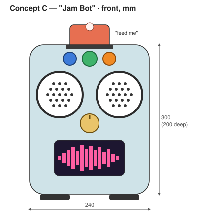
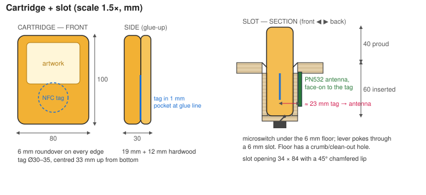

# JamBox Enclosure and Cartridge Design (v2)

The physical design for the hardwired, all-in-one JamBox. The parts list, wiring and pin map are in
[hardware.md](hardware.md).

## Decision log

Decisions are made in the [design review page](https://claude.ai/artifact/R82Ww7XMcv26h4d8bHZJkR).

All decisions were made on 2026-11-24.

| Decision | Choice |
|---|---|
| Box design | **Concept B, "Jam Radio"**. See the Radio build details below |
| Body material | **Baltic birch plywood** (12 mm + 6 mm) |
| Slot liner | **HDPE** slot insert in the top panel |
| Computer | **Raspberry Pi 4, 4 GB** |
| Amplifier | **HiFiBerry Amp4** |
| Speakers | **Dayton PC83-4** pair |
| LED display | **Adafruit NeoPixel Shield 5×8** (#1430), portrait, as a jukebox-style equaliser (changed 2026-11-27 from the NeoMatrix 8×8) |
| Cartridge presence | **NFC-only + click detent**. The microswitch is an optional add-on if the slot test shows laggy or false pauses |
| Portable power | **Wall power only** for v1. The battery spike below stays as a future option |
| Carry handle | **None** (removed 2026-11-27). The box lives plugged into a wall; lift it with two hands under the ends |
| Layout fixes | **Decided 2026-11-27** from the [design review](design/jam-radio-review.html): full-height speaker chambers and a 144 mm bay, a 32 mm slot with 15 + 15 mm cartridges, sled on rails, USB-C and power button in the 12 mm back panel. See "Inside the radio" |
| Cartridges | **Laminated hardwood blocks** (tag sealed at the glue line). Printed cartridges are a stretch goal on branch `claude/3d-printed-cartridges` |
| 3D printing | **Your Ender 3 Pro** (slot mock-up, LED grid, brackets, cartridge experiments) |
| Re-inserting a cartridge | **Resume if within ~30 minutes**, otherwise start over |
| Volume ceiling | **Parent-adjustable** in the web app, starting at ~80 dB |
| Control buttons | **24 mm mini LED arcade buttons** (Adafruit #3430 red Back, #3433 green Play/Pause, #3431 yellow Skip), decided 2026-11-27 for a neater radio look. LEDs need 5 V |
| Volume knob | **Maple Shaker knob, 51 mm** (Woodcraft 2-pack), epoxied on (decided 2026-11-27; replaces the aluminium backup knob) |
| Wiring | **Keyed JST-XH plugs at the sled end** (pre-crimped leads, no crimper), soldered and heat-shrunk at the device end, a Perma-Proto HAT for the GPIO breakout. The breadboard is for the bench prototype only (decided 2026-11-27) |
| LED 5 V supply | **Adafruit MPM3610** 1.2 A buck (decided 2026-11-27; replaces the Pololu D36V28F5) |

## Design goals

- **Players:** ages 2 to 6. It will be dropped, sat on, drooled on and fed things that aren't cartridges.
- **Lives on the floor**, so it needs a low centre of gravity, a wide base and rubber feet.
- **Stays put:** it lives in one spot, plugged into the wall. No handle (one less thing to hang on). Battery is an optional spike.
- **One USB-C cable.** No external speakers, no second power brick.
- **Cartridges:** chunky blocks that slide into a slot. **In = cue up and play. Out = pause.**
- **Controls:** volume knob; Back, Play/Pause and Skip buttons; an on/off light; a dancing LED display.
- **Buildable with a table saw and router.** A 3D printer is optional; see the decision below.
- **Attractive enough to live in the living room.**

All three concepts share the same electronics, controls and cartridge, so the choice is purely
about looks, build effort and play value.

---

## Concept A: "Jam House"


A little house. **The cartridge posts into a slot in the roof ridge.** Each window is a speaker,
the front door is the LED display, and the **doorknob is the volume knob**. The three buttons sit on the
front roof slope, angled toward a child sitting in front of it.

| | |
|---|---|
| Size | **300 W × 180 D × 272 H mm** (11.8" × 7.1" × 10.7") to the ridge. 320 mm wide with the roof overhang; +40 mm with a cartridge in; +10 mm feet |
| Weight | ≈ 3–3.5 kg (7 lb) in 12 mm Baltic birch with electronics |
| Carry | Hand-hold slots routed through both gable ends |
| Build | Straight cuts plus 45° bevels on the table saw; roundovers, hand-holds and grille holes with the router or drill press |

**Why it's recommended:**
- "Post the block in the roof" is an action a 2-year-old understands instantly.
- The house metaphor gives every control a reason to be where it is.
- It's low and wide for floor play.
- Every part is a flat panel you can cut on a table saw.
- It looks like a piece of nice wooden furniture, not a gadget.

## Concept B: "Jam Radio" (chosen)


A retro tabletop radio. The cartridge drops into a slot centred on top. Round drilled grilles on each
side, the arched LED "dial" in the middle, buttons below it, and the volume knob on top at the back right.
(The concept drawing still shows a carry handle; it was removed on 2026-11-27.)

| | |
|---|---|
| Size | **360 W × 170 D × 200 H mm** (14.2" × 6.7" × 7.9"); +10 mm feet, +40 mm with a cartridge in |
| Weight | ≈ 3 kg |
| Carry | None. Two hands under the ends |
| Build | A plain rectangular box: glued butt joints with glue blocks, large roundovers, two drilled grilles. The fastest build |

**Pros:** the most stable shape (very low), the best stereo spacing, and the simplest joinery.
**Cons:** less character unless you paint it.

## Concept C: "Jam Bot" (most playful)



A friendly robot head you **"feed"** cartridges through the top of its head. Speaker eyes, a nose that's
the volume knob, and a wide LED **mouth that sings** (8×16 pixels). The buttons sit on its forehead.

| | |
|---|---|
| Size | **240 W × 200 D × 300 H mm** (9.4" × 7.9" × 11.8") |
| Weight | ≈ 3 kg |
| Carry | A hand-hold slot in the top behind the slot, or side hand-holds |
| Build | A box with large-radius corners, which needs a router template. Two 8×8 matrices (or one 8×32 panel cut down) for the mouth |

**Pros:** the most personality, and the singing mouth is the best showcase for the LED visualizer.
**Cons:** the tallest and narrowest, so more tip-prone on carpet. Weight it low and use a wider base. The
large-radius corners take more jig work.

## Comparison

| | A: House | B: Radio | C: Bot |
|---|---|---|---|
| Toddler appeal (2–4) | ★★★ | ★★ | ★★★ |
| Still cool at 5–6 | ★★ | ★★★ | ★★★ |
| Floor stability | ★★★ | ★★★ | ★★ |
| Portability | ★★ (hand-holds) | ★ (no handle; wall-powered) | ★★ |
| Build effort (table saw + router) | Medium | **Low** | Medium-high |
| Stereo separation | Good (170 mm) | Best (246 mm) | Fair (120 mm) |
| LED display | 8×8 "door" | 5×8 "dial" (portrait) | 8×16 "mouth" |
| Looks like furniture | ★★★ | ★★★ | ★ |

**Chosen: B (Radio).** It's the easiest build and the most stable on the floor.
Paint and the LED "dial" give it character. My original pick was A (House). Its drawings and cut list
stay below for reference.

---

## The cartridge



| Spec | Value | Reason |
|---|---|---|
| Size | **80 W × 100 H × 30 T mm**, tolerance **±0.5 mm** on width and thickness | Fills a toddler's two hands. Far larger than the small-parts cylinder (31.7 mm Ø), so no choking hazard |
| Edges | 6 mm (¼") roundover everywhere (the box itself uses 10 mm) | No sharp edges; slides into the slot easily |
| Tag | NTAG215, **Ø30–35 mm**, at the **centre of the thickness** (15 mm from each face), centred **28 mm up from the bottom** | Two equal 15 mm halves put the tag exactly in the middle, so it reads the same whichever way it faces. Low, so it's fully inside the slot |
| Insertion | **60 mm in, 40 mm sticking out** to grab | Enough to grip and pull, and the tag is always inside |
| Weight | ≈ 150–180 g in maple | Satisfying heft; stays put in the slot |
| Magnets | **None** | Presence is sensed by NFC (the microswitch is optional). Loose magnets are an ingestion hazard, so the design avoids them completely |

The cartridge is symmetric front-to-back, so it can face either way with the same read gap. The only
"wrong" way in is upside-down, and the flat bottom with artwork on top makes the right way obvious. If you
want it fool-proof, the software can map a second tag in the top end to the same song.

### No stickers on the outside

Jamie peels stickers, so **the tag is never on a surface**. It's sealed inside every cartridge: at the glue
line of a wood block, or embedded mid-print in a printed one. **Artwork isn't a sticker either**: use paint
sealed under finish, engraving, or a raised printed icon. A label on the outside is something to pick at.

### Three ways to make cartridges

1. **Laminated hardwood block (recommended for v1, no printer).**
   - Plane ¾" maple or cherry down to **15 mm** and rip it to 80 mm wide. Cut **two 15 mm pieces** per cartridge, 100 mm long, so the glue line (and the tag) sits exactly in the middle.
   - Drill a 1 mm-deep, 35 mm Forstner pocket in the mating face of one piece. Drop in the tag and glue the two pieces together with Titebond III. The tag ends up sealed permanently at the glue line.
   - After glue-up, run every cartridge through the planer or a drum sander to **30.0 mm (±0.5)** and check it with calipers or a 30 mm gauge block. Thickness is what sets the read gap.
   - Round over all edges, sand to 220 grit, and finish.
   - Batch production: rip one long blank, cross-cut ten at once with a stop block, and route all the roundovers in one pass.
2. **3D-printed character cartridge.**
   - Print in PETG (tougher than PLA) with 4+ walls and 25–40% infill. Add a pause at the layer just above a tag pocket, drop in the tag, and the printer prints over it.
   - Multicolour prints allow real characters: an animal, a vehicle, a star.
   - Don't use them as teething toys. Printed layer lines can't be sanitised as well as finished wood.
3. **Hybrid.** A wood block as in option 1, with a printed or painted character relief glued into a shallow routed pocket on the part that sticks out.

**Artwork ideas:** wood-burned or painted icons, printed images sealed under finish, a makerspace laser
engraving, or colour-coding by type (songs = yellow, lullabies = blue, stories = green). Because the song
mapping lives in the web app, a cartridge can be reassigned at any time without rebuilding it.

**Cartridge "garage":** a 12 mm plywood rack with 10 slots of 34 mm (looser than the box slot on purpose) gives a home for the
cartridges and turns tidy-up into a game. It's easy to make with the table saw and a dado stack.

### Slot design

- The slot is **32 × 84 mm** (1 mm clearance per side on thickness, 2 mm on width), cut in a 12 mm **HDPE insert**
  with a **45° × 6 mm chamfered lip** that funnels small hands. HDPE is slippery, so the tighter fit still slides easily.
- The insert is **130 × 50 × 12 mm, stepped**, made from **two layers of the ¼" (6 mm) HDPE sheet**: the top layer is
  110 mm long and the bottom layer 130 mm, so it drops in from below and can't be pulled out the top. No glue (HDPE
  won't take it); the step and the cleats hold both layers. The top panel's hole is stepped to match (110 × 50 at the top face,
  130 × 50 in the bottom 6 mm).
- A **6 mm plywood sleeve** (inside 32 × 84 mm) hangs 48 mm below the 12 mm top, for 60 mm of insertion. Its end walls
  are glued to two 6 mm plywood cleats that hold the insert's ends up.
- The **PN532** sits in a **45 × 45 mm pocket routed 3 mm deep** into the outside of the sleeve's back wall, so only
  3 mm of plywood is between the antenna and the cartridge. Centre the antenna on the tag (z ≈ 168); the board's top edge
  then sits just under the top panel. Hold it with nylon screws.
  **Read gap: 18–20 mm** (15 mm to the tag + 0–2 mm clearance + 3 mm wall), whichever way the cartridge faces.
  Bench-test this before final glue-up (see hardware.md §5).
- **Keep metal 30 mm or more from the PN532.** The insert itself has no screws. The two cleats are screwed to the
  top panel at the slot's ends, ≥ 50 mm from the reader.
- **Presence sensing (open decision).** The NFC reader can tell when a cartridge leaves: when the tag
  stops answering for a few polls, pause. That works with no extra parts. A switch adds three things:
  1. **Speed.** The removal check is instant, instead of a few missed polls (~1–1.5 s with a 0.5 s poll).
  2. **No false pauses.** A single flaky NFC read mid-song can't be mistaken for removal, so the NFC
     debounce can be more forgiving.
  3. **"Something's in, but I can't read it."** It can show a "?" for an unregistered or damaged cartridge.

  A roller-lever microswitch gives almost **no tactile feel**. Its actuation force is tiny, so it doesn't
  "click" for the child. **Updated recommendation:** start **NFC-only**, and test it in the printed slot mock-up
  (experiment E3). For feel, add a **detent**: a small printed or wooden spring bump in the slot wall that
  snaps into a shallow groove on each cartridge face, so it clicks in and holds. Use no metal
  ball-plungers near the antenna. Add the microswitch later only if E3 shows laggy or false pauses.
  If you use it, it sits under the sleeve floor with its lever through a 6 mm slot.

  **Decided:** NFC-only is the default and the switch is an optional add-on. Wherever older notes say "presence
  is sensed by a microswitch", read NFC.
- Either way, a **clean-out hole** in the slot floor lets crumbs and juice drain out. In the Radio it must drain
  to the outside, not onto the electronics below (see "Heat and airflow").
- **Wear liner (decided):** the slot is an **HDPE** insert (cutting-board plastic). It shrugs off thousands of
  insertions, is transparent to NFC, and routes cleanly.

**Play semantics:** cartridge in → cue up and play. Out → pause. The same cartridge back in within
~30 minutes → resume where it left off. A different cartridge → start its track.
The software changes are in [the v2 plan](plans/2026-11-24-hardwired-v2.md).

---

## Inside the radio (chosen design)

Revised 2026-11-27 to fix the design review's findings: no handle, full-height speaker chambers, a wider bay, and the
power entry moved to the back panel. Coordinates are from the front-left-bottom outside corner:
x across (0–360), y front to back (0–170), z up (0–200).

```
 front view                                          top view
 ┌────────────────────────────────────────────┐       ┌────────────────────────────────────────────┐
 │ ┌────────┐┊      ╭────╮      ┊┌────────┐   │       │ back panel: USB-C, power, vents  [knob ◯]  │
 │ │ ◌◌◌◌◌◌ │┊      │LED │      ┊│ ◌◌◌◌◌◌ │   │       │               ┌──────┐                     │
 │ │ ◌ L  ◌ │┊      │5×8 │      ┊│ ◌ R  ◌ │   │       │               │ slot │  (centred)          │
 │ │ ◌◌◌◌◌◌ │┊      └────┘      ┊│ ◌◌◌◌◌◌ │   │       │ ┌chamber L┐   └──────┘   ┌chamber R┐       │
 │ │        │┊    ◉   ◉   ◉     ┊│        │   │       │ └─────────┘              └─────────┘       │
 │ └────────┘┊   [sled behind]  ┊└────────┘   │       └──────────────── front ─────────────────────┘
 └────────────────────────────────────────────┘
   chambers run the full inside height; ┊ = 6 mm chamber walls
```

| | |
|---|---|
| Outside | **360 W × 170 D × 200 H mm** on four 10 mm screw-on feet. No handle |
| Shell | 12 mm Baltic birch, **glued butt joints** (front and back full size, sides between them, top and bottom inside) with 12 × 12 mm plywood glue blocks along every inside edge. Inside: 336 × 146 × 176 mm |
| Speaker chambers | One at each end, **full inside height**, using the side, top, bottom and front panels as four of their walls. A 6 mm inner wall and a 6 mm back wall close each one. Inside **90 W × 176 H × 64 D mm ≈ 1.0 L**, loosely filled with polyfill. Seal every joint with glue or caulk |
| Drivers | PC83-4 centred in each chamber at x = 57 / 303, z = 100 (**246 mm apart**), screwed to the inside of the front panel behind its grille (no cutout; the grille holes are the opening) |
| Grilles | An **84 mm circle of 6 mm holes** over each driver (it has to fit inside the 90 mm chamber), with steel mesh and grille cloth behind. For a bigger look, a 100 mm V-groove ring around the holes |
| Centre bay | **144 mm wide** between the chamber walls (x 108–252) in the front 82 mm. Behind the chambers (y > 82) the whole 336 mm width is open |
| LED window | **52 W × 84 H mm**: a 70 mm-tall rectangle (z 80–150) with a 14 mm segmental arch on top (to z 164). The 5×8 LED field (~39 × 64 mm) sits inside the rectangle, so **the arch hides no LEDs**. Maple-veneer diffuser glued to the **back of a 1.5 mm recess at the front face**, egg-crate grid behind it |
| Buttons | Three **24 mm mini LED arcade buttons** (Back red, Play/Pause green, Skip yellow) at z = 48, x = 140 / 180 / 220 (40 mm apart). Hole **24 mm** (15/16" Forstner; test in scrap first). The 12 mm panel is inside their ~15 mm limit. With ~30 mm nuts they clear the chamber walls by ~17 mm and the window by ~17 mm. Their bodies reach y ≈ 45, clear of the sled. **Threadlock or epoxy each nut**: the bezel is small enough to fit the small-parts cylinder, so a button must never come loose |
| Slot | **Centred** in the top: x = 180, y = 85. Stepped HDPE insert 130 × 50 × 12 mm with a 32 × 84 mm slot. Sleeve hangs to z = 134; PN532 in a 3 mm-wall pocket on the sleeve's back wall (y ≈ 104). It is ≥ 60 mm from the LED shield, the Pi and the driver magnets |
| Knob | Encoder through the top at **x = 300, y = 120** (back right, behind the right chamber), counterbored from below to ~3–4 mm of panel. With no handle there's nothing near it to pinch a finger. Maple Shaker knob, 51 mm across, epoxied on |
| Electronics sled | 6 mm ply, **136 W × 95 D mm**, rides on two 10 × 10 mm hardwood rails glued to the bottom panel (y 63–158). The Pi lies sideways (85 mm across the bay) on 10 mm nylon standoffs; buck and HUSB238 beside it. The 10 mm gap under the sled is the air inlet |
| Back panel | 12 mm, with a **260 × 98 mm service opening** whose sill is level with the rail tops (z 22–120), so **the sled slides straight out**. Above the opening: the **USB-C panel jack and the lit power button**, mounted in the 12 mm panel (22 mm counterbore 6 mm deep from outside, so the plug sits recessed and a tugged cable pulls free), the outlet vents, and the slot drain |
| Service cover | 6 mm, 280 × 118 mm, over the opening. Inlet holes along its bottom edge. Four tamper-resistant Torx screws into threaded inserts in the back panel |

**Clearances (check in the mock-up):** Pi + Amp4 + proto HAT on the sled reaches z ≈ 88, 32 mm under the opening's top
edge. The sled's front edge (y 63) is 16 mm behind the button bodies. The sleeve floor (z 134) is 46 mm above the stack.

### Heat and airflow (Radio)

**Heat budget while playing: about 6–9 W** (about 12 W worst case):

| Source | Heat |
|---|---|
| Pi 4 streaming | ~3–5 W |
| Amp4 at toddler volume, including its 5 V regulator for the Pi | ~1–2 W |
| LED matrix at the 20% cap | ~1–2 W, mostly at the front window |
| 5 V buck and PD trigger | < 0.5 W |

The web UI builds as static files off the device (on a laptop or in CI); no Node runs on the Pi. Builds would be the 12 W case.

**Where the heat goes:** plywood barely conducts heat. The bay's outside walls pass only ~0.2 W per °C, so a
sealed bay would sit 30–40 °C above the room. Nearly all the heat must leave by **natural convection** (a chimney):
cool air in at the bottom, warm air out high on the back. The speaker chambers are sealed and play no part, so only
the centre bay (144 mm wide at the front, full width behind the chambers) vents.

**Vent sizing:** about **20 cm² in and 20 cm² out**, about 70 × 6 mm holes each, keeps the bay air ~15 °C above
the room. The Pi then runs at about **65–70 °C** in a 22 °C room; it throttles at 80 °C. Halving the vent area
roughly doubles the rise to ~25 °C, which is too close to the limit.

- **Inlet:** a hole grid in the bottom panel under the sled (lifted 10 mm by the feet), plus a row of holes
  **low on the service cover**. The second inlet keeps the box breathing when it sits on carpet or a blanket.
- **Outlet:** holes **high on the back panel**, above the service opening (z ≈ 150–180), clear of the USB-C and
  power button. No vents in the top panel: that's where juice and crumbs land.
- **Sled:** it rides on 10 mm rails, so air flows under it from the bottom grid. Drill a hole grid through the sled
  under the Pi too, and stand the Pi on 10 mm nylon standoffs so air reaches the underside of the board.
- **Pi + Amp4 stack:** the Amp4 sits over the Pi's SoC heatsink. Use the extra-tall stacking header for a
  larger gap. A taller finned SoC heatsink is a cheap upgrade if the test runs warm.
- **Crumb-hole fix:** the slot's 10 mm clean-out hole is above the electronics. Run an 8 mm (5/16") vinyl tube
  from it, falling about 8 mm over ~50 mm, to a hole in the back panel at z ≈ 126, just above the service opening,
  so spills never land on the sled.
- **Software guard:** if the Pi passes ~75 °C, dim the LEDs and lower the volume ceiling, and log it.
- **Outside:** the case should stay barely warm, so it's safe to touch.

### Cut list (Concept B, chosen)

12 mm Baltic birch unless noted. Glued butt joints (Titebond III) with 12 × 12 mm glue blocks along the inside edges.

| Part | Qty | Size (mm) | Notes |
|---|---|---|---|
| Front | 1 | 360 × 200 | Two 84 mm grille fields of 6 mm holes (centres x 57 / 303, z 100). 52 × 84 arched LED window (z 80–164) with a 1.5 mm diffuser recess. Three 24 mm button holes at z 48, x 140 / 180 / 220. 10 mm (3/8") roundover on the outside edges |
| Back | 1 | 360 × 200 | 260 × 98 service opening (z 22–120). Above it: USB-C jack and 19 mm power-button holes (22 mm × 6 mm counterbores from outside), outlet vents, 8 mm drain hole at z ≈ 126. Threaded inserts for the cover |
| Sides | 2 | 146 × 200 | Fit between front and back. No hand-holds (they'd open the sealed chambers) |
| Top | 1 | 336 × 146 | Stepped slot hole for the HDPE insert, centred at x 180, y 85. Encoder hole at x 300, y 120, counterbored from below |
| Bottom | 1 | 336 × 146 | Two 10 × 10 hardwood sled rails, ~20 cm² vent grid under the sled, 4 screw-on feet |
| Service cover | 1 | 280 × 118, **6 mm** | Row of inlet holes along the bottom edge. 4 tamper-resistant screws |
| Chamber inner walls | 2 | 64 × 176, **6 mm** | Between the front panel and the chamber back wall, at x 102–108 and 252–258 |
| Chamber back walls | 2 | 96 × 176, **6 mm** | At y 76–82. A small caulked hole for the speaker wire |
| Slot insert | 2 layers | 110 × 50 and 130 × 50, **6 mm HDPE** | Stacked into a stepped 12 mm insert. 32 × 84 slot, 45° × 6 mm chamfer |
| Slot cleats | 2 | 50 × 30, **6 mm** | Under the insert's ends; screwed to the top, ≥ 50 mm from the PN532 |
| Slot sleeve | 1 set | **6 mm** | 2 × (96 × 48) long walls capturing 2 × (32 × 48) ends; floor 96 × 44 with a 10 mm drain hole. 45 × 45 × 3 mm PN532 pocket in the back wall |
| Electronics sled | 1 | 136 × 95, **6 mm** | Rides on the rails. Vent grid under the Pi |
| Sled rails | 2 | 10 × 10 × 95, **hardwood** | y 63–158, glued to the bottom |

The printed slot mock-up on the 3D branch (`hardware/3d/slot_mockup.scad`) matches this slot. Print it first to test fit and NFC.

## Inside the house (Concept A, for reference)

```
            ┌──── ridge cap (slot) ────┐
           /     [sleeve]  [PN532]      \        ← attic
          / ◉ ◉ ◉ buttons (front roof)   \   vents (back roof)
   ┌────────────────────────────────────────┐
   │ [spk chamber L]   door/LED   [spk chamber R] │  ← front wall
   │                   [matrix]                   │
   │                    knob                      │
   │  ─────── electronics sled (slides out the back) ──────  │
   │  [Pi 4 + Amp4]   [5V buck] [PD trigger] [JST terminal]  │
   └──────────────────────────────────────── back: USB-C, power button
```

- **Speaker chambers:** each driver is rear-mounted behind its window into its own **sealed 6 mm ply box**
  (~100 × 110 × 80 mm internal, ≈ 0.85 L), loosely stuffed with polyfill. Sealing them keeps the drivers
  from pressurising the electronics bay, and keeps sound from leaking out of the vent holes.
  For best bass, model the box in WinISD with the PC83-4's published T/S parameters. 0.8–1 L is a
  sensible compact starting point.
- **Grilles:** a grid of **6 mm holes** drilled through the front wall in four "panes" per window. Back it with
  **perforated steel mesh**, then grille cloth. Fingers and pencils can't reach the cone.
- **Electronics sled:** a 6 mm plywood tray that slides in grooves on the bottom panel. Everything
  connects through JST-XH plugs, so the whole sled comes out the back for service.
- **Airflow:** drilled vents in the bottom (lifted 10 mm by the feet) and high on the back roof slope.
  Warm air rises out and cool air comes in from below. Test with an hour of playback. The Pi 4
  should stay below ~70 °C (`vcgencmd measure_temp`).
- **Keep metal away from the PN532:** no screws, inserts or speaker magnets within 30 mm.
- **Back panel:** a 12 mm back wall with a 220 × 150 mm service opening. A 6 mm cover holds the **recessed
  USB-C** port and the **illuminated power button**, fixed with tamper-resistant Torx screws into threaded inserts.
  The USB-C sits in a 10 mm-deep routed pocket, so a tugged cable pulls out instead of snapping the port.

### Cut list (Concept A, for reference)

12 mm Baltic birch unless noted.

| Part | Qty | Size (mm) | Notes |
|---|---|---|---|
| Gable ends | 2 | 180 W × 260 H, cut to a pentagon (45° slopes, 60 mm flat top) | Hand-hold slot 100 × 26, centred 40 mm below the eave line. Rabbet the front/back edges 6 mm |
| Front wall | 1 | 276 × 200 | 2× window grilles, LED door opening 72 × 72, knob hole (encoder size) |
| Back wall | 1 | 276 × 200 | 220 × 150 service opening |
| Bottom | 1 | 276 × 156 | Dado grooves for the sled; vent holes |
| Roof panels | 2 | 320 × 95 | 45° bevel on both long edges. Front: 3 button holes (check the button's hole size, usually 28 mm). Back: vent holes |
| Ridge cap | 1 | 320 × 76 | Slot 34 × 84 with a 45° chamfer; or HDPE |
| Service cover | 1 | 236 × 166, **6 mm** | USB-C pocket, power-button hole |
| Speaker chamber panels | 2 sets | **6 mm** | ~100 × 110 × 80 internal per chamber |
| Slot sleeve | 1 set | **6 mm** | 2 × (96 × 60) long walls capturing 2 × (34 × 60) ends; floor 96 × 46 |
| Electronics sled | 1 | 250 × 140, **6 mm** | |
| Door overlay | 1 | 90 × 130, **6 mm maple** | 72 × 72 window; diffuser behind |

Joinery: rabbets plus Titebond III. Use no visible fasteners except on the service cover.
Round every outside edge with a 6 mm roundover before assembly where reachable, and after where not.

---

## Materials: is there something better than wood?

| Material | Verdict | Notes |
|---|---|---|
| **Baltic birch plywood** | **Recommended for the body** | Void-free, stable (doesn't warp), strong glue joints, attractive layered edges, cuts and routes cleanly. About 0.7 g/cm³ |
| Solid hardwood (maple, cherry, walnut) | **Best for cartridges and accents** | Beautiful and tough. Wide panels move with humidity, so it's riskier for a 300 mm box with captured panels. Heavier and costlier |
| Bamboo plywood | Good premium alternative | Very hard, beautiful, about twice the cost, and harder on tooling |
| **HDPE sheet** (King StarBoard, cutting-board stock) | **Excellent for the slot liner / ridge cap**; possible whole-body "indestructible" version | Nearly unbreakable, wipeable, NFC-transparent, comes in colours, and cuts on a table saw and router. Glue doesn't hold, so it needs screwed joinery. It's heavier and looks like playground equipment |
| MDF | Avoid | Swells with spills, weak edges, heavy |
| Acrylic | Diffuser only | Cracks when dropped |
| 3D-printed enclosure | Inserts only | Limited by print-bed size, weaker at corners, very long prints |

**Wood and NFC:** wood density has a negligible effect at 13.56 MHz. Distance and nearby metal matter.
Any of the woods above works; just keep the wall between antenna and tag thin (6 mm).

**Finish:** a water-based finish labelled **toy-safe / EN 71-3 / ASTM F963**, applied in thin coats and
fully cured (follow the manufacturer's cure time, often several weeks for hardwax oils) before Jamie
plays with it. Non-toxic milk paint or toy-safe acrylics for colour accents (roof, door, windows).

---

## LED display: what it does

**Decided 2026-11-27: Adafruit NeoPixel Shield 5×8 (#1430), mounted portrait (5 wide × 8 tall).** It is a
rectangle that suits the radio's "dial", draws less than the 8×8 (~0.48 A worst case at the 20% cap), and 5×8 is
also a classic character cell, so it can show letters, digits and simple icons.

The goal is a display that **dances with the music like a jukebox or a valve radio's tuning eye**.

### Look

- **Window:** **52 W × 84 H mm, portrait**, centred above the buttons: a 70 mm-tall rectangle (z 80–150) with a
  14 mm segmental **arch** on top (a jukebox/cathedral-radio arch, cut with a router template). The 5 × 8 LED field
  (~39 × 64 mm at ~8.5 mm pitch) fits inside the rectangle, so the arch sits **above** the grid and hides no LEDs.
  Confirm the LED field size from Adafruit's board files before cutting (pitch unverified).
- **Diffuser:** 0.6 mm maple veneer for a warm wooden glow (or 3 mm opal acrylic for crisper pixels), glued into a
  1.5 mm recess at the **front face**, so the glow sits flush with the wood instead of deep in a hole.
- **Egg-crate grid:** a 5 × 8 printed grid at the measured pitch, about 6–8 mm deep, between the LEDs and the
  diffuser so each pixel reads as a lit "valve segment".
- **Palette:** warm only, like old radio dial lamps: amber at the bottom of a bar, orange in the middle, red at
  the top. No blue or white while playing, which is also kinder to small eyes at bedtime.

### Behaviours

| State | Animation |
|---|---|
| Booting (~30–40 s) | "Valves warming up": the whole field fades up from deep red to amber |
| On, idle | A slow amber breathing glow (the "dial lamp"). With the lit power button, this is the on indicator |
| Cartridge in | A **tuning sweep**: a bright column sweeps left to right like a radio dial needle finding a station (~1 s), then the music starts |
| Playing | A **5-band graphic equaliser**: bass on the left to treble on the right, each band an 8-segment bar rising from the bottom, amber → orange → red, with a **peak dot** that holds briefly and falls slowly. A strong bass beat brightens the bottom row for a moment |
| Paused / cartridge out | Bars sink to the bottom row and settle into the idle glow |
| Unknown cartridge | A "?" glyph in the 5×8 cell, gently pulsing, to prompt a parent to map it |
| Turning the knob | A volume level (0–8 rows lit across all five columns) for 2 s, capped at the parent's ceiling |

### How it works

The audio is copied into an ALSA loopback device. **cava** computes a 5-band spectrum from it (bass to treble,
roughly 60 / 150 / 400 Hz / 1 kHz / 2.5 kHz and up) at ~30 fps, and a small Python service drives the LEDs over SPI
with `rpi_ws281x`. The shield is wired as 8 × 5 rows; the service rotates it 90° in software to get the portrait
5 × 8 layout. Brightness is capped at about 20%. Wire the shield's DIN, 5 V and ground pads directly (no Arduino
headers), with a 1000 µF cap across 5 V. Details are in the [v2 plan](plans/2026-11-24-hardwired-v2.md).

---

## Toddler safety checklist

- [ ] **No small parts.** Cartridges and the knob are larger than the small-parts cylinder (31.7 mm Ø); glue the knob on.
      The 24 mm buttons are smaller, so they are held from inside: **threadlock or epoxy every button nut** and check
      that no button can be pulled or pried out from the front.
- [ ] **No magnets**, no button cells, **no battery inside the box**.
- [ ] All outside edges are rounded over (10 mm on the box, 6 mm on cartridges), with no sharp corners or splinters (sand to 220).
- [ ] **No pinch points.** No handle, hinges or lids. The slot's chamfered lip guides fingers out of the gap, and the knob
      has nothing beside it.
- [ ] Speaker grilles: holes ≤ 6 mm, with steel mesh behind.
- [ ] Tamper-resistant screws on the service cover only. No other fasteners are exposed.
- [ ] **Volume cap** set in software. Aim for ≤ ~85 dB at Jamie's ear distance and check with a phone SPL app.
- [ ] Toy-safe finish, fully cured.
- [ ] **Feet:** screw-on rubber feet only (no adhesive pads a child can peel off).
- [ ] **Stability:** push and lean test on carpet. Mount the heaviest parts (sled, speakers) low.
- [ ] **Thermal:** an hour of loud play, with the Pi under ~70 °C (`vcgencmd measure_temp`) and the case not warm to the touch.
  Run it twice: on a hard floor, and on carpet with a blanket against the back.
- [ ] **Cord:** a short USB-C cable routed behind furniture. Recessed port so it pulls free rather than tipping the box.
- [ ] **Spill test:** pour a little water into the slot; it must drain out of the box, not onto the sled.
- [ ] **Drop test** from about 75 cm onto carpet; check joints and that the electronics sled stays put.

---

## 3D printer decision

**You already have an Ender 3 Pro, so no purchase or print service is needed for prototyping.**
The enclosure and wood cartridges are still entirely table-saw and router work. The printer handles the slot mock-up,
the LED pixel grid, brackets, and the printed-cartridge exploration (branch `claude/3d-printed-cartridges`,
`docs/plans/2026-11-24-3d-printed-cartridges.md`). The original guidance follows.

A printer becomes worth it if you want:
- **Character cartridges** in colour (the most compelling reason).
- The **LED egg-crate grid**, which noticeably upgrades how the display looks.
- Fast iteration on brackets: the PN532 mount, microswitch holder, cable clips, a custom knob.

**Middle path:** order the handful of brackets and the LED grid from an online print service
(JLC3DP, Craftcloud, a local library or makespace) and build wood cartridges. If you later want
character cartridges, a **Bambu Lab A1-class printer** with multi-colour support is the
easy-mode choice (~$250–450 depending on model and bundle; verify current pricing).

---

## Battery spike: portable power without new risk

The power design takes **any USB-C PD source with a 15 V profile**. That gives a portable
option without putting a battery inside a toddler toy.

| Option | Safety | Verdict |
|---|---|---|
| **External UL 2056-certified USB-C PD power bank** (20,000 mAh+, 15 V output, 45 W+) plugged into the existing USB-C port | Best. A certified product, kept outside the box | **Recommended.** No changes to the box. Carry it in a pouch strapped to the back, or set it behind the box |
| Internal UPS HAT with LiFePO4 cells (e.g. AQEX Stubborn Stamina LF, 52Pi UPS) | LiFePO4 is the most thermally stable lithium chemistry, but these are hobby boards without independent safety certification. They'd sit inside a box that gets dropped. Most are designed for a 5 V-powered Pi, not the Amp4's 15 V input | Not recommended. It would need a power redesign |
| DIY 18650 Li-ion pack | Highest risk | **No** |

**Runtime estimate:** typical draw is 6–9 W. A 20,000 mAh (≈ 72 Wh) bank at ~85% efficiency
gives **6–9 hours**.

**Rules:**
- The bank must list **15 V** on its USB-C output (the box won't start on 5 V or 9 V).
- Don't charge the bank while it's inside a bag or enclosed space.
- Don't use pass-through charging long-term; it runs warm.
- Unplug the bank when it isn't in use.

The read-only OS means an empty bank or a pulled cable won't corrupt anything.

---

## Suggested build order

1. **Bench prototype.** Pi 4 + Amp4 + one driver + PN532 + microswitch + one button on the desk. Land
   the software changes (wired audio, insert/remove, controls).
2. **NFC test.** A real 30 mm cartridge, a 3 mm plywood wall, 18–20 mm gap, read 20/20 in both orientations.
3. **Mock-up box** in cheap plywood (Concept B is ideal). Check acoustics, temperature and LED diffusion.
4. **Cartridges.** Batch of 10 plus the garage rack.
5. **Final enclosure.** Cut, dry-fit, glue, round over, finish and cure.
6. **Safety checklist** above, then hand it to Jamie.

---

## Sources

- [HiFiBerry Amp4 datasheet](https://www.hifiberry.com/docs/data-sheets/datasheet-amp4/) and [GPIO usage of HiFiBerry boards](https://www.hifiberry.com/docs/hardware/gpio-usage-of-hifiberry-boards/)
- [Raspberry Pi power supply documentation](https://www.raspberrypi.com/documentation/computers/raspberry-pi.html), [Pi 4 product brief (production until Jan 2034)](https://pip-assets.raspberrypi.com/categories/545-raspberry-pi-4-model-b/documents/RP-008344-DS-5-raspberry-pi-4-product-brief.pdf), [USB PD on Raspberry Pi 5 whitepaper](https://pip-assets.raspberrypi.com/categories/685-app-notes-guides-whitepapers/documents/RP-009856-WP-1-USB%20Power%20delivery%20on%20Raspberry%20Pi%205.pdf)
- [Adafruit PN532 breakout](https://www.adafruit.com/product/364) and [PN532 guide](https://learn.adafruit.com/adafruit-pn532-rfid-nfc?view=all)
- [Adafruit HUSB238 USB-PD breakout guide](https://learn.adafruit.com/adafruit-husb238-usb-type-c-power-delivery-breakout/overview)
- [Dayton Audio PC83-4 (Parts Express)](https://www.parts-express.com/Dayton-Audio-PC83-4-3-Full-Range-Poly-Cone-Driver-295-154), [RS75-4](https://www.daytonaudio.com/product/115/rs75-4-3-reference-full-range-driver-4-ohm)
- [rpi_ws281x library (SPI on Pi 4, PWM/PCM conflicts)](https://github.com/jgarff/rpi_ws281x), [librespot events (`--onevent`)](https://github.com/librespot-org/librespot/wiki/Events)
- [PN5180 range notes (ISO 15693 vs 14443)](https://www.patreon.com/posts/rfid-roundup-23115452)
- [Yoto card slot as a separate module (repair guide)](https://support.yotoplay.com/en-US/yoto-player-(2nd-gen)-sd-card-replacement-395249), [Hacking Yoto players (Adafruit)](https://learn.adafruit.com/hacking-the-yoto-music-players)
- [Phoniebox RC522 wiring](https://github.com/AlvinSchiller/RPi-Jukebox-RFID/wiki/Wiring_for_RC522_card_reader)
- [CPSC magnet safety rule (Federal Register 2022)](https://www.govinfo.gov/content/pkg/FR-2022-09-21/html/2022-20200.htm), [CPSC magnets guidance](https://www.cpsc.gov/Business--Manufacturing/Business-Education/Business-Guidance/Magnets)
- [Polymaker: child and toy safety for 3D prints](https://wiki.polymaker.com/polymaker-products/more-about-our-products/safety-in-3d-printing/child-and-toy-safety)
- [UL 2056 power bank safety](https://www.ul.com/insights/enhance-safety-power-banks-ul-2056-testing), [AQEX LiFePO4 UPS HAT](https://www.tindie.com/products/aqex/aqex-stubborn-stamina-lf-ups-hat-for-the-pi/)
