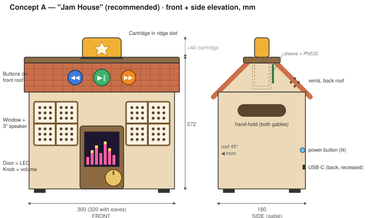
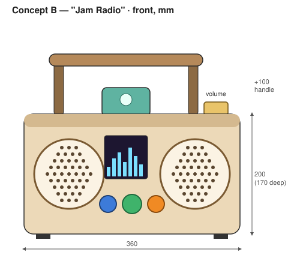

# JamBox Enclosure and Cartridge Design (v2)

The physical design for the hardwired, all-in-one JamBox. The parts list, wiring and pin map are in
[hardware.md](hardware.md).

## Design goals

- **Players:** ages 2 to 6. It will be dropped, sat on, drooled on and fed things that aren't cartridges.
- **Lives on the floor**, so it needs a low centre of gravity, a wide base and rubber feet.
- **Portable:** a parent can carry it from room to room with one hand. Battery is an optional spike.
- **One USB-C cable.** No external speakers, no second power brick.
- **Cartridges:** chunky blocks that slide into a slot. **In = cue up and play. Out = pause.**
- **Controls:** volume knob; Back, Play/Pause and Skip buttons; an on/off light; a dancing LED display.
- **Buildable with a table saw and router.** A 3D printer is optional; see the decision below.
- **Attractive enough to live in the living room.**

All three concepts share the same electronics, controls and cartridge, so the choice is purely
about looks, build effort and play value.

---

## Concept A: "Jam House" (recommended)



A little house. **The cartridge posts into a slot in the roof ridge.** Each window is a speaker,
the front door is the LED display, and the **doorknob is the volume knob**. The three buttons sit on the
front roof slope, angled toward a child sitting in front of it.

| | |
|---|---|
| Size | **300 W × 180 D × 272 H mm** (11.8" × 7.1" × 10.7") to the ridge. 320 mm wide with the roof overhang; +40 mm with a cartridge in; +10 mm feet |
| Weight | ≈ 3–3.5 kg (7 lb) in 12 mm Baltic birch with electronics |
| Carry | Hand-hold slots routed through both gable ends |
| Build | Straight cuts plus 45° bevels on the table saw; roundovers, hand-holds and grille holes with the router or drill press |

**Why it's recommended:**
- "Post the block in the roof" is an action a 2-year-old understands instantly.
- The house metaphor gives every control a reason to be where it is.
- It's low and wide for floor play.
- Every part is a flat panel you can cut on a table saw.
- It looks like a piece of nice wooden furniture, not a gadget.

## Concept B: "Jam Radio" (easiest to build)



A retro portable radio with a wooden carry handle. The cartridge drops into a slot on top under
the handle. Round drilled grilles on each side, the LED "dial" in the middle, buttons below it, and
the volume knob on top.

| | |
|---|---|
| Size | **360 W × 170 D × 200 H mm** (14.2" × 6.7" × 7.9"); +100 mm handle |
| Weight | ≈ 3 kg |
| Carry | Hardwood dowel handle between two uprights (or a leather strap) |
| Build | A plain rectangular box: rabbet joints, large roundovers, two hole-saw grilles. The fastest build |

**Pros:** the most stable shape (very low), the most portable thanks to the real handle, the best stereo
spacing, and the simplest joinery. **Cons:** less character unless you paint it. Kids can also hang on the handle,
so it needs strong through-tenons or bolts.

## Concept C: "Jam Bot" (most playful)


A friendly robot head you **"feed"** cartridges through the top of its head. Speaker eyes, a nose that's
the volume knob, and a wide LED **mouth that sings** (8×16 pixels). The buttons sit on its forehead.

| | |
|---|---|
| Size | **240 W × 200 D × 300 H mm** (9.4" × 7.9" × 11.8") |
| Weight | ≈ 3 kg |
| Carry | A hand-hold slot in the top behind the slot, or side hand-holds |
| Build | A box with large-radius corners, which needs a router template. Two 8×8 matrices (or one 8×32 panel cut down) for the mouth |

**Pros:** the most personality, and the singing mouth is the best showcase for the LED visualizer.
**Cons:** the tallest and narrowest, so more tip-prone on carpet. Weight it low and use a wider base. The
large-radius corners take more jig work.

## Comparison

| | A: House | B: Radio | C: Bot |
|---|---|---|---|
| Toddler appeal (2–4) | ★★★ | ★★ | ★★★ |
| Still cool at 5–6 | ★★ | ★★★ | ★★★ |
| Floor stability | ★★★ | ★★★ | ★★ |
| Portability | ★★ (hand-holds) | ★★★ (handle) | ★★ |
| Build effort (table saw + router) | Medium | **Low** | Medium-high |
| Stereo separation | Good (170 mm) | Best (210 mm) | Fair (120 mm) |
| LED display | 8×8 "door" | 8×8 "dial" | 8×16 "mouth" |
| Looks like furniture | ★★★ | ★★★ | ★ |

**Recommendation:** build **A (House)**. If you'd like a quick practice build first, build B in
cheap plywood as a test mule for the electronics, then build A for real.

---

## The cartridge


| Spec | Value | Reason |
|---|---|---|
| Size | **80 W × 100 H × 30 T mm** | Fills a toddler's two hands. Far larger than the small-parts cylinder (31.7 mm Ø), so no choking hazard |
| Edges | 6 mm (¼") roundover everywhere | No sharp edges; slides into the slot easily |
| Tag | NTAG215, **Ø30–35 mm**, at the **centre of the thickness**, centred **33 mm up from the bottom** | Centred in the thickness, so it reads the same whichever way it faces. Low, so it's fully inside the slot |
| Insertion | **60 mm in, 40 mm sticking out** to grab | Enough to grip and pull, and the tag is always inside |
| Weight | ≈ 150–180 g in maple | Satisfying heft; stays put in the slot |
| Magnets | **None** | Presence is sensed by a microswitch. Loose magnets are an ingestion hazard, so the design avoids them completely |

The cartridge is symmetric front-to-back. The only "wrong" way in is upside-down, and the flat
bottom with artwork on top makes the right way obvious. If you want it fool-proof, the software can map
a second tag in the top end to the same song.

### Three ways to make cartridges

1. **Laminated hardwood block (recommended for v1, no printer).**
   - Rip maple or cherry to 80 mm wide. Cut one 19 mm (¾") piece and one 12 mm (½") piece per cartridge, 100 mm long.
   - Drill a 1 mm-deep, 35 mm Forstner pocket in the mating face of one piece. Drop in the tag and glue the two pieces together with Titebond III. The tag ends up sealed permanently at the glue line.
   - Round over all edges, sand to 220 grit, and finish.
   - Batch production: rip one long blank, cross-cut ten at once with a stop block, and route all the roundovers in one pass.
2. **3D-printed character cartridge.**
   - Print in PETG (tougher than PLA) with 4+ walls and 25–40% infill. Add a pause at the layer just above a tag pocket, drop in the tag, and the printer prints over it.
   - Multicolour prints allow real characters: an animal, a vehicle, a star.
   - Don't use them as teething toys. Printed layer lines can't be sanitised as well as finished wood.
3. **Hybrid.** A wood block as in option 1, with a printed or painted character relief glued into a shallow routed pocket on the part that sticks out.

**Artwork ideas:** wood-burned or painted icons, printed images sealed under finish, a makerspace laser
engraving, or colour-coding by type (songs = yellow, lullabies = blue, stories = green). Because the song
mapping lives in the web app, a cartridge can be reassigned at any time without rebuilding it.

**Cartridge "garage":** a 12 mm plywood rack with 10 slots of 34 mm gives a home for the
cartridges and turns tidy-up into a game. It's easy to make with the table saw and a dado stack.

### Slot design

- The slot opening is **34 × 84 mm** (2 mm clearance per side), with a **45° chamfered lip** that funnels small hands.
- A **6 mm plywood sleeve** forms the slot. It hangs 60 mm down into the attic under the ridge cap.
- The **PN532** is screwed (nylon screws) to the outside of the sleeve wall, with the antenna face-on to the tag.
  The tag-to-antenna gap is **≈ 23 mm** (15 mm into the cartridge, 2 mm clearance, 6 mm wall).
  Bench-test this before final glue-up (see hardware.md §5).
- A **roller-lever microswitch** sits under the sleeve floor, with its lever through a 6 mm slot. A cartridge
  bottoming out closes it. A **clean-out hole** in the floor lets crumbs and juice drain out instead
  of jamming the switch.
- **Optional wear liner:** make the ridge cap (or just a slot insert) from **HDPE** (cutting-board plastic). It
  shrugs off thousands of insertions, is transparent to NFC, and routes cleanly.

**Play semantics:** cartridge in → cue up and play. Out → pause. The same cartridge back in within
~30 minutes → resume where it left off. A different cartridge → start its track.
The software changes are in [the v2 plan](plans/2026-11-24-hardwired-v2.md).

---

## Inside the house

```
            ┌──── ridge cap (slot) ────┐
           /     [sleeve]  [PN532]      \        ← attic
          / ◉ ◉ ◉ buttons (front roof)   \   vents (back roof)
   ┌────────────────────────────────────────┐
   │ [spk chamber L]   door/LED   [spk chamber R] │  ← front wall
   │                   [matrix]                   │
   │                    knob                      │
   │  ─────── electronics sled (slides out the back) ──────  │
   │  [Pi 4 + Amp4]   [5V buck] [PD trigger] [JST terminal]  │
   └──────────────────────────────────────── back: USB-C, power button
```

- **Speaker chambers:** each driver is rear-mounted behind its window into its own **sealed 6 mm ply box**
  (~100 × 110 × 80 mm internal, ≈ 0.85 L), loosely stuffed with polyfill. Sealing them keeps the drivers
  from pressurising the electronics bay, and keeps sound from leaking out of the vent holes.
  For best bass, model the box in WinISD with the PC83-4's published T/S parameters. 0.8–1 L is a
  sensible compact starting point.
- **Grilles:** a grid of **6 mm holes** drilled through the front wall in four "panes" per window. Back it with
  **perforated steel mesh**, then grille cloth. Fingers and pencils can't reach the cone.
- **Electronics sled:** a 6 mm plywood tray that slides in grooves on the bottom panel. Everything
  connects through JST-XH plugs, so the whole sled comes out the back for service.
- **Airflow:** drilled vents in the bottom (lifted 10 mm by the feet) and high on the back roof slope.
  Warm air rises out and cool air comes in from below. Test with an hour of playback. The Pi 4
  should stay below ~70 °C (`vcgencmd measure_temp`).
- **Keep metal away from the PN532:** no screws, inserts or speaker magnets within 30 mm.
- **Back panel:** a 12 mm back wall with a 220 × 150 mm service opening. A 6 mm cover holds the **recessed
  USB-C** port and the **illuminated power button**, fixed with tamper-resistant Torx screws into threaded inserts.
  The USB-C sits in a 10 mm-deep routed pocket, so a tugged cable pulls out instead of snapping the port.

### Cut list (Concept A)

12 mm Baltic birch unless noted.

| Part | Qty | Size (mm) | Notes |
|---|---|---|---|
| Gable ends | 2 | 180 W × 260 H, cut to a pentagon (45° slopes, 60 mm flat top) | Hand-hold slot 100 × 26, centred 40 mm below the eave line. Rabbet the front/back edges 6 mm |
| Front wall | 1 | 276 × 200 | 2× window grilles, LED door opening 72 × 72, knob hole (encoder size) |
| Back wall | 1 | 276 × 200 | 220 × 150 service opening |
| Bottom | 1 | 276 × 156 | Dado grooves for the sled; vent holes |
| Roof panels | 2 | 320 × 95 | 45° bevel on both long edges. Front: 3 button holes (check the button's hole size, usually 28 mm). Back: vent holes |
| Ridge cap | 1 | 320 × 76 | Slot 34 × 84 with a 45° chamfer; or HDPE |
| Service cover | 1 | 236 × 166, **6 mm** | USB-C pocket, power-button hole |
| Speaker chamber panels | 2 sets | **6 mm** | ~100 × 110 × 80 internal per chamber |
| Slot sleeve | 1 set | **6 mm** | 2 × (96 × 60) long walls capturing 2 × (34 × 60) ends; floor 96 × 46 |
| Electronics sled | 1 | 250 × 140, **6 mm** | |
| Door overlay | 1 | 90 × 130, **6 mm maple** | 72 × 72 window; diffuser behind |

Joinery: rabbets plus Titebond III. Use no visible fasteners except on the service cover.
Round every outside edge with a 6 mm roundover before assembly where reachable, and after where not.

---

## Materials: is there something better than wood?

| Material | Verdict | Notes |
|---|---|---|
| **Baltic birch plywood** | **Recommended for the body** | Void-free, stable (doesn't warp), strong glue joints, attractive layered edges, cuts and routes cleanly. About 0.7 g/cm³ |
| Solid hardwood (maple, cherry, walnut) | **Best for cartridges and accents** | Beautiful and tough. Wide panels move with humidity, so it's riskier for a 300 mm box with captured panels. Heavier and costlier |
| Bamboo plywood | Good premium alternative | Very hard, beautiful, about twice the cost, and harder on tooling |
| **HDPE sheet** (King StarBoard, cutting-board stock) | **Excellent for the slot liner / ridge cap**; possible whole-body "indestructible" version | Nearly unbreakable, wipeable, NFC-transparent, comes in colours, and cuts on a table saw and router. Glue doesn't hold, so it needs screwed joinery. It's heavier and looks like playground equipment |
| MDF | Avoid | Swells with spills, weak edges, heavy |
| Acrylic | Diffuser only | Cracks when dropped |
| 3D-printed enclosure | Inserts only | Limited by print-bed size, weaker at corners, very long prints |

**Wood and NFC:** wood density has a negligible effect at 13.56 MHz. Distance and nearby metal matter.
Any of the woods above works; just keep the wall between antenna and tag thin (6 mm).

**Finish:** a water-based finish labelled **toy-safe / EN 71-3 / ASTM F963**, applied in thin coats and
fully cured (follow the manufacturer's cure time, often several weeks for hardwax oils) before Jamie
plays with it. Non-toxic milk paint or toy-safe acrylics for colour accents (roof, door, windows).

---

## LED display: what it does

The 8×8 matrix sits behind a diffuser (3 mm opal acrylic, or 0.6 mm maple veneer that glows warm).
A small **"egg-crate" grid** between the LEDs and the diffuser makes each pixel crisp. It's an easy 3D print, or
can be made from strips of card or thin ply. Planned behaviours:

| State | Animation |
|---|---|
| Booting (~30–40 s) | A slow "sunrise" fill, so Jamie knows it's waking up |
| On, idle | A gentle breathing glow (the "porch light"). Together with the lit power button, this is the on indicator |
| Playing | **Audio-reactive spectrum bars** (8 bands) that dance to the music |
| Paused / cartridge out | Bars freeze and fade to the idle glow |
| Unknown cartridge | A friendly "?" or a blinking face, to prompt a parent to map it in the web app |
| Turning the knob | A volume bar for 2 s |

How it works: the audio is copied into an ALSA loopback device. **cava** computes the spectrum
from it, and a small Python service drives the LEDs over SPI using `rpi_ws281x`. Brightness is capped at about 20%
for eyes and power. Details are in the [v2 plan](plans/2026-11-24-hardwired-v2.md).

---

## Toddler safety checklist

- [ ] **No small parts.** Cartridges, knob and button caps are all larger than the small-parts cylinder
      (31.7 mm Ø). Glue the knob on and use arcade buttons that can't be pried apart.
- [ ] **No magnets**, no button cells, **no battery inside the box**.
- [ ] All outside edges have a 6 mm roundover, with no sharp corners or splinters (sand to 220).
- [ ] **No pinch points.** The slot has generous clearance and there are no hinges or lids a child can open.
- [ ] Speaker grilles: holes ≤ 6 mm, with steel mesh behind.
- [ ] Tamper-resistant screws on the service cover only. No other fasteners are exposed.
- [ ] **Volume cap** set in software. Aim for ≤ ~85 dB at Jamie's ear distance and check with a phone SPL app.
- [ ] Toy-safe finish, fully cured.
- [ ] **Stability:** push and lean test on carpet. Mount the heaviest parts (sled, speakers) low.
- [ ] **Thermal:** an hour of loud play, with the Pi under ~70 °C and the case not warm to the touch.
- [ ] **Cord:** a short USB-C cable routed behind furniture. Recessed port so it pulls free rather than tipping the box.
- [ ] **Drop test** from about 75 cm onto carpet; check joints and that the electronics sled stays put.

---

## 3D printer decision

**You don't need one for v1.** The enclosure and wood cartridges are entirely table-saw and router work.

A printer becomes worth it if you want:
- **Character cartridges** in colour (the most compelling reason).
- The **LED egg-crate grid**, which noticeably upgrades how the display looks.
- Fast iteration on brackets: the PN532 mount, microswitch holder, cable clips, a custom knob.

**Middle path:** order the handful of brackets and the LED grid from an online print service
(JLC3DP, Craftcloud, a local library or makespace) and build wood cartridges. If you later want
character cartridges, a **Bambu Lab A1-class printer** with multi-colour support is the
easy-mode choice (~$250–450 depending on model and bundle; verify current pricing).

---

## Battery spike: portable power without new risk

The power design takes **any USB-C PD source with a 15 V profile**. That gives a portable
option without putting a battery inside a toddler toy.

| Option | Safety | Verdict |
|---|---|---|
| **External UL 2056-certified USB-C PD power bank** (20,000 mAh+, 15 V output, 45 W+) plugged into the existing USB-C port | Best. A certified product, kept outside the box | **Recommended.** No changes to the box. Carry it in a pouch strapped to the back, or set it behind the box |
| Internal UPS HAT with LiFePO4 cells (e.g. AQEX Stubborn Stamina LF, 52Pi UPS) | LiFePO4 is the most thermally stable lithium chemistry, but these are hobby boards without independent safety certification. They'd sit inside a box that gets dropped. Most are designed for a 5 V-powered Pi, not the Amp4's 15 V input | Not recommended. It would need a power redesign |
| DIY 18650 Li-ion pack | Highest risk | **No** |

**Runtime estimate:** typical draw is 6–9 W. A 20,000 mAh (≈ 72 Wh) bank at ~85% efficiency
gives **6–9 hours**.

**Rules:**
- The bank must list **15 V** on its USB-C output (the box won't start on 5 V or 9 V).
- Don't charge the bank while it's inside a bag or enclosed space.
- Don't use pass-through charging long-term; it runs warm.
- Unplug the bank when it isn't in use.

The read-only OS means an empty bank or a pulled cable won't corrupt anything.

---

## Suggested build order

1. **Bench prototype.** Pi 4 + Amp4 + one driver + PN532 + microswitch + one button on the desk. Land
   the software changes (wired audio, insert/remove, controls).
2. **NFC test.** A real cartridge, a 6 mm plywood wall, 23 mm gap, read 20/20 in both orientations.
3. **Mock-up box** in cheap plywood (Concept B is ideal). Check acoustics, temperature and LED diffusion.
4. **Cartridges.** Batch of 10 plus the garage rack.
5. **Final enclosure.** Cut, dry-fit, glue, round over, finish and cure.
6. **Safety checklist** above, then hand it to Jamie.

---

## Sources

- [HiFiBerry Amp4 datasheet](https://www.hifiberry.com/docs/data-sheets/datasheet-amp4/) and [GPIO usage of HiFiBerry boards](https://www.hifiberry.com/docs/hardware/gpio-usage-of-hifiberry-boards/)
- [Raspberry Pi power supply documentation](https://www.raspberrypi.com/documentation/computers/raspberry-pi.html), [Pi 4 product brief (production until Jan 2034)](https://pip-assets.raspberrypi.com/categories/545-raspberry-pi-4-model-b/documents/RP-008344-DS-5-raspberry-pi-4-product-brief.pdf), [USB PD on Raspberry Pi 5 whitepaper](https://pip-assets.raspberrypi.com/categories/685-app-notes-guides-whitepapers/documents/RP-009856-WP-1-USB%20Power%20delivery%20on%20Raspberry%20Pi%205.pdf)
- [Adafruit PN532 breakout](https://www.adafruit.com/product/364) and [PN532 guide](https://learn.adafruit.com/adafruit-pn532-rfid-nfc?view=all)
- [Adafruit HUSB238 USB-PD breakout guide](https://learn.adafruit.com/adafruit-husb238-usb-type-c-power-delivery-breakout/overview)
- [Dayton Audio PC83-4 (Parts Express)](https://www.parts-express.com/Dayton-Audio-PC83-4-3-Full-Range-Poly-Cone-Driver-295-154), [RS75-4](https://www.daytonaudio.com/product/115/rs75-4-3-reference-full-range-driver-4-ohm)
- [rpi_ws281x library (SPI on Pi 4, PWM/PCM conflicts)](https://github.com/jgarff/rpi_ws281x), [librespot events (`--onevent`)](https://github.com/librespot-org/librespot/wiki/Events)
- [PN5180 range notes (ISO 15693 vs 14443)](https://www.patreon.com/posts/rfid-roundup-23115452)
- [Yoto card slot as a separate module (repair guide)](https://support.yotoplay.com/en-US/yoto-player-(2nd-gen)-sd-card-replacement-395249), [Hacking Yoto players (Adafruit)](https://learn.adafruit.com/hacking-the-yoto-music-players)
- [Phoniebox RC522 wiring](https://github.com/AlvinSchiller/RPi-Jukebox-RFID/wiki/Wiring_for_RC522_card_reader)
- [CPSC magnet safety rule (Federal Register 2022)](https://www.govinfo.gov/content/pkg/FR-2022-09-21/html/2022-20200.htm), [CPSC magnets guidance](https://www.cpsc.gov/Business--Manufacturing/Business-Education/Business-Guidance/Magnets)
- [Polymaker: child and toy safety for 3D prints](https://wiki.polymaker.com/polymaker-products/more-about-our-products/safety-in-3d-printing/child-and-toy-safety)
- [UL 2056 power bank safety](https://www.ul.com/insights/enhance-safety-power-banks-ul-2056-testing), [AQEX LiFePO4 UPS HAT](https://www.tindie.com/products/aqex/aqex-stubborn-stamina-lf-ups-hat-for-the-pi/)
